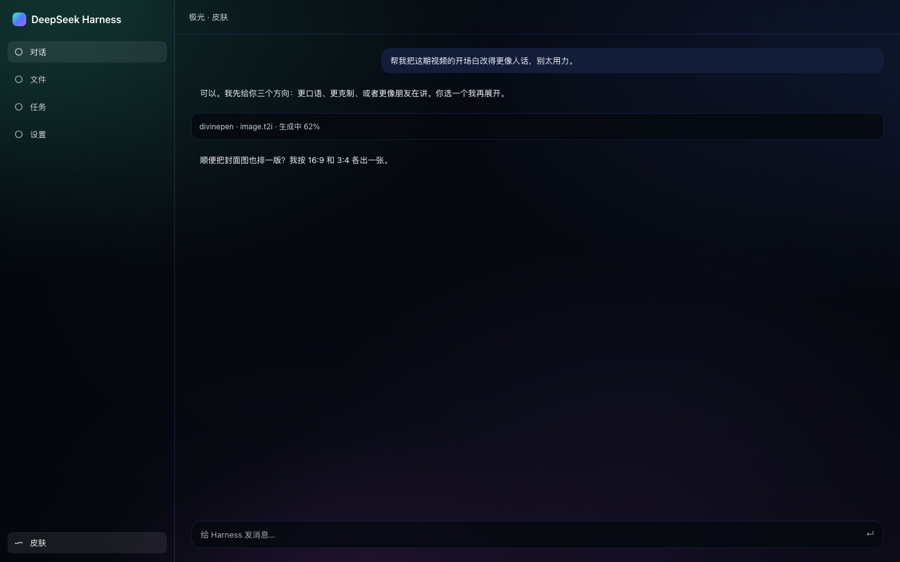

# dsh-aurora-theme

An animated aurora skin for the [DeepSeek Harness](https://github.com/deepseek-ai/deepseek-harness) Web UI —
one bundle, no build step, three palettes and seven effects. It changes how DSH looks, never what it does.

DSH Web UI 的极光皮肤：动态背景 + 半透明表面 + 三套配色 + 七个开关。装一个组合包就能用，
不改 DSH 本体，也不影响任何功能。


## 特性

- **动态背景**：四个极光色团、扫光、尘埃 canvas、胶片噪点、暗角，全部垫在界面之下。
- **三套配色**：极光（青绿/靛蓝/品红）、余烬（琥珀/玫红/紫）、薄荷（薄荷/松绿/湖蓝）。
- **七个独立开关**：光晕、尘埃、噪点、视差、呼吸、扫光、玻璃。
- **只改语义 token**：覆盖 `--dsw-alias-*`，不依赖任何哈希类名；DSH 升级时不容易被内部改动打断。
- **亮暗自适应**：`body[data-ds-dark-theme]` 自动切换整套颜色与混合模式。
- **尊重系统偏好**：`prefers-reduced-motion` 停动画，`prefers-reduced-transparency` 回到不透明。
- **无构建、无运行时依赖**：`client.js` 是手写 classic script，只从共享模块表 `require('react')`。
- **干净卸载**：停用或删除插件时，样式、背景层、`body` 属性、监听器和 rAF 一起回收。

浅色：


对话界面：



> 预览用 DSH 自己的设计 token 在无头 Chrome 里渲染，接近但不等同于真机截图。

## 安装

### 从 GitHub 安装（推荐）

```sh
dsh plugin --profile web add https://github.com/lewis6663721/dsh-aurora-theme
```

也可以在 **设置 → 插件 → 安装** 里直接粘贴这个地址。

安装完成后重启 `dsh`（从界面安装通常热生效，刷新页面即可）。左侧栏底部会出现「皮肤」入口。

### 从 tarball 安装

```sh
npm pack --pack-destination dist
dsh plugin --profile web add ./dist/dsh-aurora-theme-0.1.0.tgz
```

### 从本地目录安装（开发用）

```sh
dsh plugin --profile web add /absolute/path/to/dsh-aurora-theme
```

本地目录是 `link` 语义：移动或删除目录会让插件失效；发给别人请用 GitHub 地址或 tarball。

### 卸载

```sh
dsh plugin --profile web remove dsh-aurora-theme
```

## 使用

打开左侧栏底部的 **皮肤**：

| 区域 | 内容 |
| --- | --- |
| 配色 | 三张卡片，点击立即切换整套颜色 |
| 效果 | 七个开关，分别控制光晕、尘埃、噪点、视差、呼吸、扫光、玻璃 |
| 恢复默认 | 回到「极光 + 全部开启」 |

设置保存在**当前浏览器**的 `localStorage`（键 `dsh-aurora-theme/v1`），换设备或换浏览器不会跟随。
插件也会读取旧的 `dsh-aurora-theme` / `aurora-theme` 键做一次迁移。

## 兼容性

- **DSH**：`>=0.2.1-rc.2 <0.3.0`（写在 `engines.dsh`，安装和启动时都会检查）。
- **Profile**：Web（`dsh web` / `dsh --profile web`）。
- **pnpm**：`dsh plugin` 用它安装。
- 版本不满足时安装会失败并打印 exact-version 豁免命令；优先升级插件，不要随便豁免。
- 皮肤只覆盖观感，不注册工具、命令或服务；禁用插件不会影响会话和任务。

## 它是怎么接进去的

```
package.json  dsh.bundle.patch ──► cordis.patch.yml 插入一行 { id: aurora-theme }
              dsh.client.platform: web ──► 宿主把 client.js 作为 /plugins/dsh-aurora-theme/client.js 提供

client.js     window.__ModuleLoader__.load({ id, factory }) ──► 返回 Cordis 插件
apply(ctx)    ├─ ctx.effect(install)        背景层 + 样式 + body 属性 + 指针/可见性监听
              ├─ ctx.inject(['locale'])     注册中英词典
              └─ ctx.slots.inject(...)      侧栏入口 + 主面板页
```

- 宿主半边 `index.js` 是空的：它只需要 import 成功，客户端模块系统才能扫描到 `dsh.client`。
- 两个槽位：`sidebar.panellist`（左侧栏一行）和 `main`（主面板页），`id` 与 `key` 必须一致。
- 背景层是 `position: fixed; z-index: -1` 的独立节点，不往 React 树里塞东西。
- 表面只用 `--dsw-alias-*` / `--dsw-specific-*` token，并用 `!important` 压过主题呈现器写在
  `body` 内联样式上的值。
- 磨砂只做在皮肤页自己身上：给侧栏/主栏加 `backdrop-filter` 会给其中的 `position: fixed`
  后代创建包含块，可能弄坏弹层定位，所以刻意不做。

## 开发

```sh
npm run check
```

`tools/check.mjs` 用最小 DOM + 桩 React 跑 `client.js`，覆盖 9 项：

1. bundle 契约（`id`、`plugin.inject`、`apply`）
2. 两个槽位的注册参数（`id`/`key`/`order`/`label`）
3. 中英词典注册
4. 背景层、`body` 属性、样式标签的安装
5. 皮肤页渲染
6. 选配色后的持久化与 `body` 更新
7. 开关效果后的持久化
8. 重载后恢复
9. locale 缺席时的降级
10. 卸载清理与重复 apply 不叠层

它不验证视觉效果和真实浏览器布局——那些只能刷新看。`client.js` 没有构建步骤，
改完直接刷新页面即可；`node --check client.js` 可以兜底语法。

### 目录

```
package.json        dsh.bundle.patch + dsh.client.platform + engines.dsh
cordis.patch.yml    插入一行 { id: aurora-theme, name: dsh-aurora-theme }
index.js            Host 半边：空 apply
client.js           浏览器半边：背景层、token、两个槽位、皮肤页
icon.svg            插件列表图标
docs/               预览图
tools/check.mjs     无浏览器契约检查
```

## 故障排查

| 现象 | 原因 / 处理 |
| --- | --- |
| 装完左侧栏没有「皮肤」 | 没重启 `dsh`；或 bundle 未启用；或 DSH 版本不在兼容范围内 |
| 有入口但界面没变化 | 刷新页面；确认 `body` 上有 `data-aurora-on`（DevTools） |
| 页面太亮/太透 | 关掉「玻璃」开关；或在 `client.js` 里调低 `--dsw-alias-bg-base` 的透明度 |
| 安装被拒：版本不兼容 | 升级插件；确需运行旧版时按提示执行 `dsh plugin allow-version ... --accept-risk` |
| 卸载后仍有残留 | 刷新页面；插件卸载会移除 `#dsh-aurora-layer`、样式与 `body` 属性 |
| 换浏览器后设置没了 | 预期行为：设置按浏览器存，不跟随 profile |

## 已知限制

- 设置是**每浏览器**的，不是 profile 级；多人共用一个 DSH 时互不影响，但也不会同步。
- 手写 classic script，没有类型检查和构建期校验；靠 `node --check` 与检查脚本保底。
- 背景是纯 CSS + canvas，极端低端设备上可关掉尘埃/扫光/噪点降低开销。
- 如果 DSH 未来改动 `--dsw-alias-*` 的语义，颜色可能需要跟着调；不会影响功能。

## License

[MIT](LICENSE)
