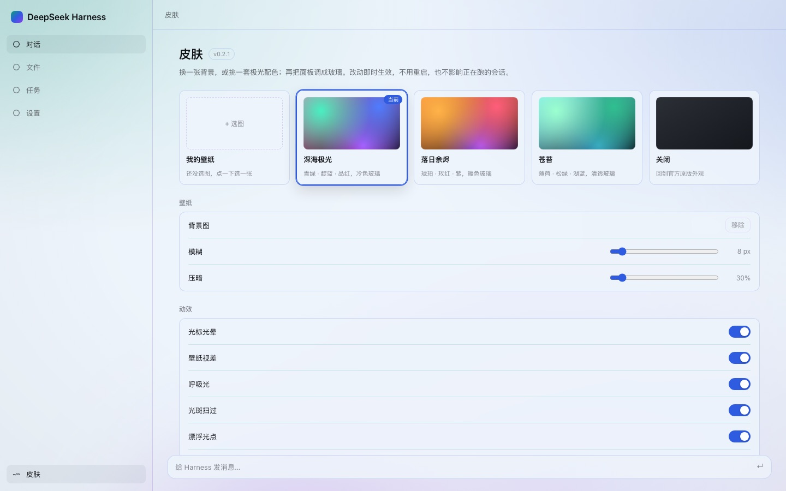
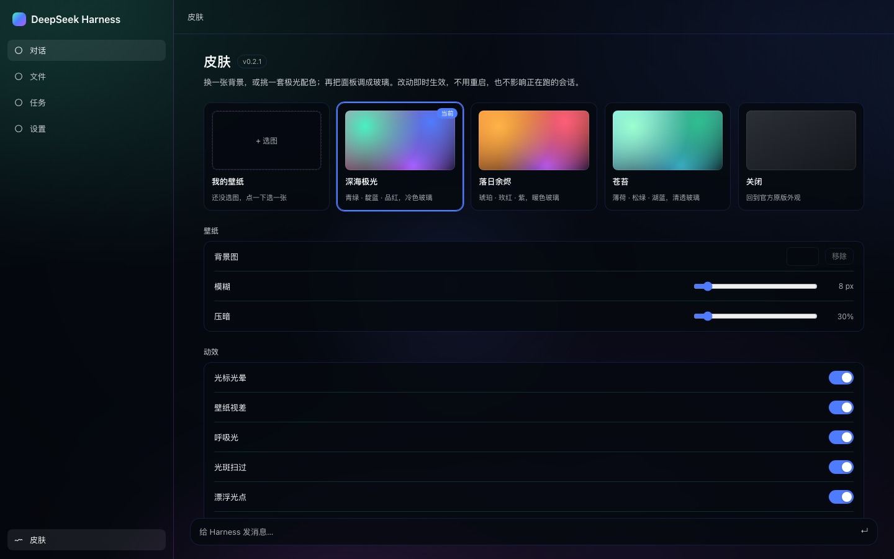

# dsh-aurora-theme

A wallpaper + aurora skin for the [DeepSeek Harness](https://github.com/deepseek-ai/deepseek-harness) Web UI —
pick your own backdrop, blur and dim it, or choose one of three aurora palettes, then turn the
panels into glass. One bundle, no build step, and it never changes what DSH does.

DSH Web UI 的壁纸皮肤：选一张自己的图（可模糊、压暗），或挑一套极光配色，再把面板调成玻璃。
装一个组合包就能用，不改 DSH 本体，也不影响任何功能。



## 特性

- **自定义壁纸**：点「我的壁纸」选一张图，图片只存本机 IndexedDB，不上传。
- **模糊 / 压暗**：两个滑杆实时作用于壁纸，值会记住。
- **三套极光配色**：深海极光（青绿/靛蓝/品红）、落日余烬（琥珀/玫红/紫）、苍苔（薄荷/松绿/湖蓝）。
- **关闭**：一键回到 DSH 官方原版外观，不留残留。
- **七个动效开关**：光标光晕、壁纸视差、呼吸光、光斑扫过、漂浮光点、颗粒噪点、分区玻璃。
- **只改语义 token**：覆盖 `--dsw-alias-*` / `--dsw-specific-*`，不依赖任何哈希类名。
- **亮暗自适应**：`body[data-ds-dark-theme]` 自动切换整套颜色与混合模式。
- **尊重系统偏好**：`prefers-reduced-motion` 停动画，`prefers-reduced-transparency` 回到不透明。
- **无构建、无运行时依赖**：`client.js` 是手写 classic script，只从共享模块表 `require('react')`。
- **干净卸载**：停用或删除插件时，样式、背景层、壁纸 URL、`body` 属性、监听器和 rAF 一起回收。

深色：



> 预览用 DSH 自己的设计 token 在无头 Chrome 里渲染，接近但不等同于真机截图。

## 安装

### 从 GitHub 安装（推荐）

```sh
dsh plugin --profile web add https://github.com/lewis6663721/dsh-aurora-theme
```

也可以在 **设置 → 插件 → 安装** 里直接粘贴这个地址。

安装完成后重启 `dsh`（从界面安装通常热生效，刷新页面即可）。左侧栏底部会出现「皮肤」入口。

### 从 tarball 安装

```sh
npm pack --pack-destination dist
dsh plugin --profile web add ./dist/dsh-aurora-theme-0.2.1.tgz
```

### 从本地目录安装（开发用）

```sh
dsh plugin --profile web add /absolute/path/to/dsh-aurora-theme
```

本地目录是 `link` 语义：移动或删除目录会让插件失效；发给别人请用 GitHub 地址或 tarball。

### 卸载

```sh
dsh plugin --profile web remove dsh-aurora-theme
```

## 使用

打开左侧栏底部的 **皮肤**：

| 区域 | 内容 |
| --- | --- |
| 外观 | 「我的壁纸」+ 三套极光配色 + 「关闭」，点一下立即切换 |
| 壁纸 | 背景图缩略图 / 移除、模糊 0–40 px、压暗 0–80% |
| 动效 | 七个开关：光标光晕、壁纸视差、呼吸光、光斑扫过、漂浮光点、颗粒噪点、分区玻璃 |

选「关闭」会回到官方原版外观；再点任意配色或壁纸即可恢复。

## 数据与隐私

- **设置**：当前浏览器的 `localStorage`，键 `dsh-aurora-theme/v2`；插件会读取旧的
  `dsh-aurora-theme/v1` / `dsh-aurora-theme` / `aurora-theme` 键做一次迁移。
- **壁纸**：当前浏览器的 IndexedDB（库 `dsh-aurora-theme`，表 `assets`，键 `wallpaper`）。
- 图片**不会上传**，也不会写进 profile 或会话；换浏览器/换设备需要重新选图。
- 移除壁纸（或卸载插件）后，IndexedDB 里的图会被删除。

## 兼容性

- **DSH**：`>=0.2.1-rc.2 <0.3.0`（写在 `engines.dsh`，安装和启动时都会检查）。
- **Profile**：Web（`dsh web` / `dsh --profile web`）。
- **pnpm**：`dsh plugin` 用它安装。
- 版本不满足时安装会失败并打印 exact-version 豁免命令；优先升级插件，不要随便豁免。
- 皮肤只覆盖观感，不注册工具、命令或服务；禁用插件不会影响会话和任务。

## 它是怎么接进去的

```
package.json  dsh.bundle.patch ──► cordis.patch.yml 插入一行 { id: aurora-theme }
              dsh.client.platform: web ──► 宿主把 client.js 作为 /plugins/dsh-aurora-theme/client.js 提供

client.js     window.__ModuleLoader__.load({ id, factory }) ──► 返回 Cordis 插件
apply(ctx)    ├─ ctx.effect(install)        背景层 + 样式 + body 属性 + 指针/可见性监听
              ├─ ctx.inject(['locale'])     注册中英词典
              └─ ctx.slots.inject(...)      侧栏入口 + 主面板页
```

- 宿主半边 `index.js` 是空的：它只需要 import 成功，客户端模块系统才能扫描到 `dsh.client`。
- 两个槽位：`sidebar.panellist`（左侧栏一行）和 `main`（主面板页），`id` 与 `key` 必须一致。
- 背景层是 `position: fixed; z-index: -1` 的独立节点：壁纸 ``、极光色团、光标光晕、
  扫光、尘埃 canvas、噪点、暗角都在这层里。
- 壁纸用 `blur(calc(var(--a-blur) * 1px)) brightness(...)` 实时响应滑杆，不重挂 DOM。
- 表面只用 `--dsw-alias-*` / `--dsw-specific-*` token，并用 `!important` 压过主题呈现器写在
  `body` 内联样式上的值。
- 「关闭」不销毁插件：移除 `data-aurora-on`，token 覆盖失效、背景层 `display:none`。
- 磨砂只做在皮肤页自己的卡片上：给侧栏/主栏加 `backdrop-filter` 会给其中的
  `position: fixed` 后代创建包含块，可能弄坏弹层定位，所以刻意不做。

## 开发

```sh
npm run check
```

`tools/check.mjs` 用最小 DOM + 桩 React 跑 `client.js`，覆盖 11 项：

1. bundle 契约（`id`、`plugin.inject`、`apply`）
2. 两个槽位的注册参数（`id`/`key`/`order`/`label`）
3. 中英词典注册
4. 背景层、`body` 属性、样式标签的安装
5. 皮肤页五张卡片、两个滑杆、七个开关的渲染
6. 选配色后的持久化与 `body` 更新
7. 「关闭」移除 `data-aurora-on`
8. 开关效果后的持久化
9. 滑杆写入 CSS 变量并持久化
10. 重载后恢复、locale 缺席时的降级
11. 卸载清理与重复 apply 不叠层

它不验证视觉效果和真实浏览器布局——那些只能刷新看。`client.js` 没有构建步骤，
改完直接刷新页面即可；`node --check client.js` 可以兜底语法。

### 目录

```
package.json        dsh.bundle.patch + dsh.client.platform + engines.dsh
cordis.patch.yml    插入一行 { id: aurora-theme, name: dsh-aurora-theme }
index.js            Host 半边：空 apply
client.js           浏览器半边：背景层、壁纸、token、两个槽位、皮肤页
icon.svg            插件列表图标
docs/               预览图
tools/check.mjs     无浏览器契约检查
```

## 故障排查

| 现象 | 原因 / 处理 |
| --- | --- |
| 装完左侧栏没有「皮肤」 | 没重启 `dsh`；或 bundle 未启用；或 DSH 版本不在兼容范围内 |
| 有入口但界面没变化 | 刷新页面；确认 `body` 上有 `data-aurora-on` 与 `data-aurora-mode`（DevTools） |
| 选了壁纸但没显示 | 浏览器禁用了 IndexedDB，或图片类型不受支持；换一张 PNG/JPEG 再试 |
| 壁纸太亮/太透 | 调大「压暗」；关掉「分区玻璃」 |
| 安装被拒：版本不兼容 | 升级插件；确需运行旧版时按提示执行 `dsh plugin allow-version ... --accept-risk` |
| 卸载后仍有残留 | 刷新页面；插件卸载会移除背景层、样式、`body` 属性与壁纸 URL |
| 换浏览器后设置没了 | 预期行为：设置与壁纸都按浏览器存，不跟随 profile |

## 已知限制

- 壁纸和设置都是**每浏览器**的，不是 profile 级；多人共用一个 DSH 时互不影响，但也不会同步。
- 手写 classic script，没有类型检查和构建期校验；靠 `node --check` 与检查脚本保底。
- 背景是 CSS + canvas，极端低端设备上可关掉漂浮光点/光斑扫过/颗粒噪点降低开销。
- 如果 DSH 未来改动 `--dsw-alias-*` 的语义，颜色可能需要跟着调；不会影响功能。

## License

[MIT](LICENSE)
